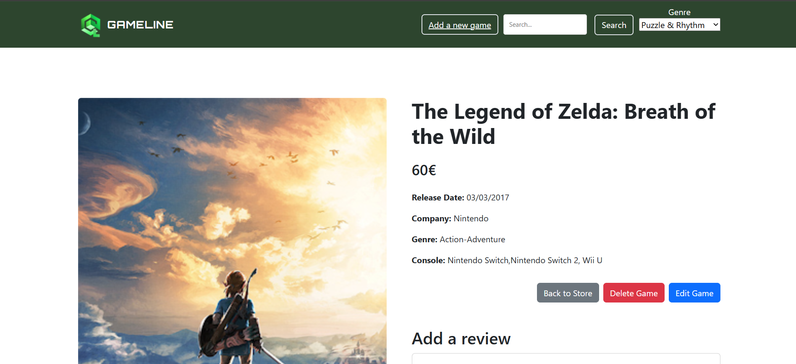
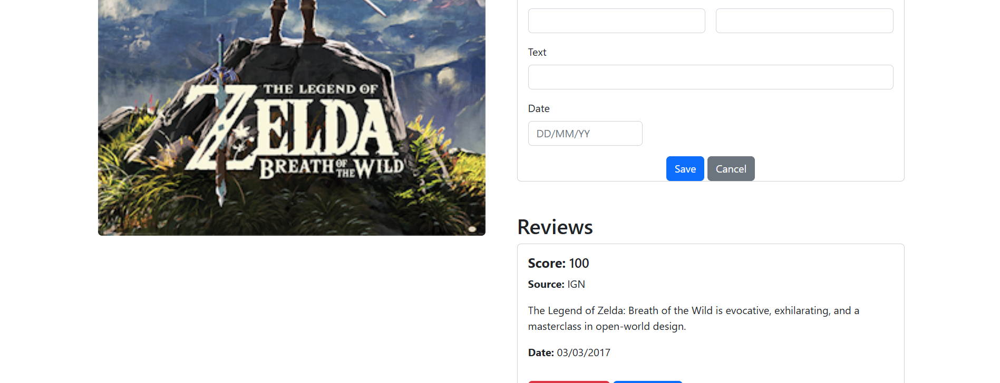
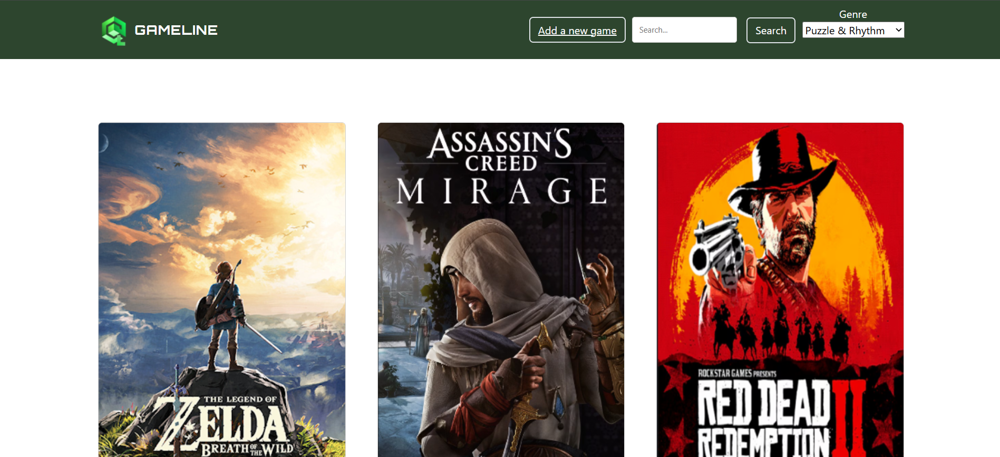
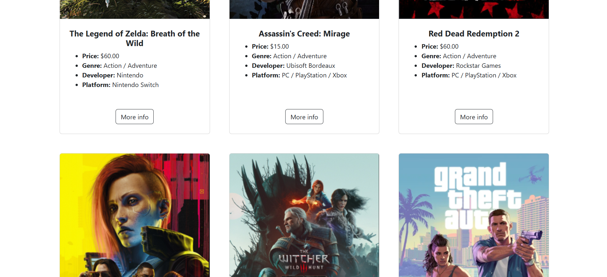
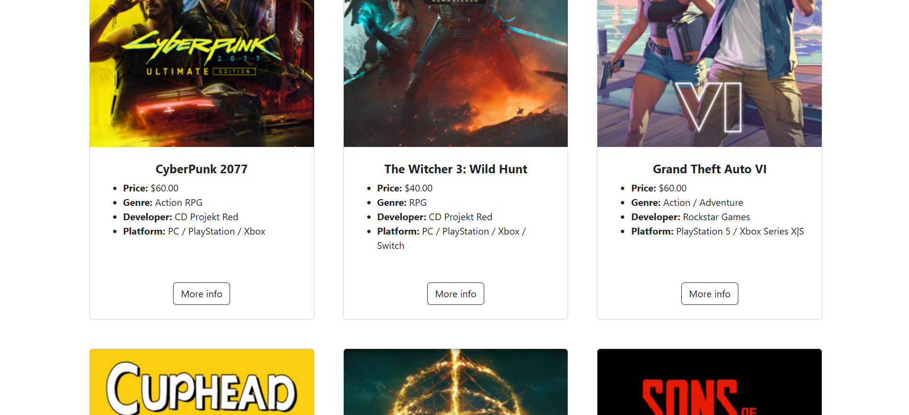
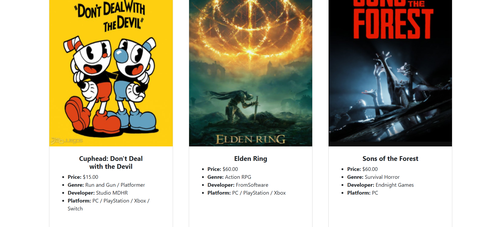
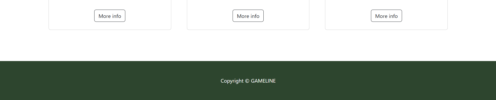
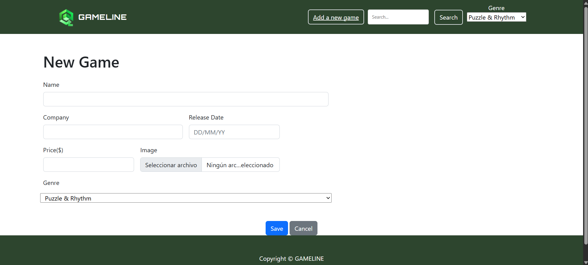

#  GAMELINE : _A web for browsing videogames_
## Project members


| NAME | EMAIL | GITHUB USER |
| ------------- | ------------- | ------------- |
| David González Pato | d.gonzalezp.2025@alumnos.urjc.es | paatiito |
| Leonardo Di Salvo Alonso | l.di.2025@alumnos.urjc.es | Leeo1405 |
| Asier Zapata Fernández-Gallardo |	a.zapata.2025@alumnos.urjc.es |	asierzzzz |
| Aitor Mouzo Navarro |	a.mouzo.2025@alumnos.urjc.es | Aiitoorr |

## App description
***Gameline*** will be an app aimed at all video game enthusiasts. It will offer a wide selection of the best titles from various companies, accompanied by reviews from the industry's most reliable analysts, allowing any player to determine whether a game is worth the investment. You will also be able to see data from each game featured on the website as the date of release and the gaming consoles it launched at.

## Functionality

### Entities
The main entities are going to be the videogames itselves:
| VIDEOGAME | TYPE |
| ------------- | ------------- |
|  `Name` | `String` |
|  `Cover` |`Image`|
| `Price`|`Integer`|
|  `Release date` |`String [DD/MM/YYYY]`|
| `Company` |`String`|
| `Genre` |`[Action (FPS/TPS Shooters, Platforming, Hack and Slash, Fighting, Beat 'em up, Battle Royale) Adventure (Graphic Adventure, Visual Novel, Walking Simulator, Survival Horror) Role-Playing / RPG (JRPG, ARPG, MMORPG, Tactical RPG, Roguelike, Roguelite) Strategy (RTS, TBS, MOBA, Tower Defense, Grand Strategy) Simulation (Life Sim, Vehicle Sim, Management & Construction, Sandbox) Sports & Driving (Sports Sim, Arcade Sports, Racing, Driving Sim) Puzzle & Rhythm (Logic, Riddles, Music Games, Card Games, Digital Board Games)] `|
| `Console` |`String`|

The secondary entities are going to be each game review, which can be uploaded by any user or game reviewer platform like IGN, OpenCritic...
| REVIEW | TYPE |
| ------------- | ------------- |
|  `Score` |`[1..100]`|
|  `Source` |`string`|
|  `Text` |`string`|
|  `Date` |`String [DD/MM/YYYY]`|

### IMAGES
- Each game must have a cover so it can be easily identified by every user.
- The reviews may or may not have an image related to the game.
- The web logo will also be a featured image.

### Extra features
- The web will feature a search engine to look for key words related to the games.
- It will also be possible to filter the games by price or release date.
These features will improve the user experience browsing in our web.

## PRÁCTICA 1
### Screenshots
#### About


#### Index





#### Details Page

### PARTICIPATION
#### Asier Zapata Fernández-Gallardo
- I chose the template, started the index page and helped create all of the other pages and have a common direction.
- The page i worked the most on is `index`, but i also helped in `about` and `new` inserting the header and the footer and helping formatting the pages.  
- My 5 more significative commits are:
  - [added template files for the project](https://github.com/CodeURJC-FW-2026-27/webapp12/commit/62e73b39bd61b65f6a1f8596e73caaefeb47d690)   
  - [edited template to show 9 elements, changed header and footer, and divs dimensions](https://github.com/CodeURJC-FW-2026-27/webapp12/commit/e2eaf5208984b22bd9c613be6677636a1616edd3)
  - [changed the template to have a new game button and linked all of the buttons to the about page](https://github.com/CodeURJC-FW-2026-27/webapp12/commit/c5f61990c1ad4c8598ea3a7f416dcc44c4f256c4)
  - [Changed the header in about and in new to match index and also added a review and updated review system in new so the form to add a new review is on top of the reviews itselves](https://github.com/CodeURJC-FW-2026-27/webapp12/commit/3a95b04636f2a6a1e0163cf18adef54db7128d1c)
  - [added header and footer to the new.html file, and added fonts to the head section of the html file](https://github.com/CodeURJC-FW-2026-27/webapp12/commit/90115f7b264fe1ad8004960fa50387a77b554a87)

### Leonardo Di Salvo Alonso
- I worked primarily on the visual aspects of the page, helping to organize the interface and the presentation.
- The page i worked the most on is `index`.
- [Added product details for them to show price, genre, developer and platforms on each of the games](https://github.com/CodeURJC-FW-2026-27/webapp12/commit/9ab3abed3dc9c9836cfe723fda857efa0c17e6ac)
- [Added and placed all of the images and game names](https://github.com/CodeURJC-FW-2026-27/webapp12/commit/ac82d814a0f191307cf7955404a0aa327a17ee9c)
- [Changed some malfunctioning buttons and fixed the cart`s functionality and aspect](https://github.com/CodeURJC-FW-2026-27/webapp12/commit/d9d3100744a55f5e01740ae8c8dfbcebc6dc2370)
- [Changed Sales Item's names](https://github.com/CodeURJC-FW-2026-27/webapp12/commit/bb625da485d773ea646c35d91e0321dd69e8d0a3)
- [Removed innecesary badges from the main games cards](https://github.com/CodeURJC-FW-2026-27/webapp12/commit/576591fcafcae2949edc62c926215465194642c6)

   - ### David González Pato
- I started the page for creating a new item (`New`) and helped finish the remaining pages.
- The page I worked on the most was `New`, but I also collaborated on the `about` and `new` pages by adding various buttons that reference game genres.
- My 5 more significative commits are:
  - [Add the different category types.](https://github.com/CodeURJC-FW-2026-27/webapp12/commit/82f592822b193a152a49cf4b4e7344b921cbe48f)
  - [Creation of fields for adding a new game](https://github.com/CodeURJC-FW-2026-27/webapp12/commit/9f5c9102704b9fe96ea70a51319847ba28e28035)
  - [Add the Save and Cancel buttons, where the Cancel button redirects to the main page when clicked.](https://github.com/CodeURJC-FW-2026-27/webapp12/commit/1b4e2b1a08b908522f93e2ba971867b667da2c61)
  - [Removal of duplicate buttons](https://github.com/CodeURJC-FW-2026-27/webapp12/commit/a5dcc433520c1e3b04e8912b45716b3d6f8d8616)
  - [Properly link the game images so they appear on the website.](https://github.com/CodeURJC-FW-2026-27/webapp12/commit/747448a81ff335d42ee55dcb50738f605567edb6)
    #### Aitor Mouzo Navarro
  - Most of my work was focused on the About page, where I developed most of the structure and added the content.
  - I also helped with some small presentation details on the Index page.
  - My 5 more significative commits are:
     - [ADDED ABOUT SECTION.](https://github.com/CodeURJC-FW-2026-27/webapp12/commit/5b3af21d9922515f515f3b5a5f271d43bdd92940)
     - [DELETE BUTTON AND EDIT BUTTON ADDED TO ABOUT.HTML](https://github.com/CodeURJC-FW-2026-27/webapp12/commit/83f76ada2ba4daf885873e046a300fb8e7144273)
     - [BACK BUTTON ADDED TO ABOUT PAGE](https://github.com/CodeURJC-FW-2026-27/webapp12/commit/1f7f5f66ea80cba5815aeeaa83728de029028d24)
     - [Add,Delete and Edit buttons added to the about.html page.](https://github.com/CodeURJC-FW-2026-27/webapp12/commit/c35060e9be19c04109b8434322459e7e1ca2ffc9)
     - [Detailing the changes made to the about.html file, it appears that a style attribute was added to the div with the class "card".](https://github.com/CodeURJC-FW-2026-27/webapp12/commit/2f3fb0f04cbfc09270bf5b1df08747cd3f809fc5)


## PRÁCTICA 2

### Execution instructions
#### Requirements
- **Node.js** 18 or later (it includes `npm`)
- **MongoDB** 6.0 or later, running locally on the default port `27017` without authentication
- **Git**

#### Steps
```bash
# 1. Download the code
git clone https://github.com/CodeURJC-FW-2026-27/webapp12.git
cd webapp12

# 2. Install the dependencies
npm install

# 3. Start MongoDB (if it is not already running as a service)
mongod --dbpath <folder-for-the-database>

# 4. Start the application (in another terminal, from the project folder)
npm start
```
5. Open http://localhost:3000/ in the browser.

When the database is empty, the sample games and reviews are loaded automatically at startup and their images are copied to the `uploads/` folder. If the database already has data, nothing is loaded.

## File description

### Root
| File | Responsibility |
| ------------- | ------------- |
| `package.json` / `package-lock.json` | Project metadata, dependencies (express, mustache-express, multer, mongodb) and the `start` and `watch` scripts. |
| `.gitignore` | Excludes `node_modules/` and `uploads/` from the repository. |
| `README.md` | Project documentation. |

### `src/` (server code)
| File | Responsibility |
| ------------- | ------------- |
| `app.js` | Entry point. Creates the Express server, configures Mustache, static files and form parsing, registers the router and the error handler, and listens on port 3000. |
| `router.js` | All the routes: main page (pagination, search and genre filter), game detail/create/edit/delete, review create/edit/delete, image serving. It also contains the server-side validation of games and reviews and the helpers that render the confirmation and error pages. |
| `board.js` | Data access layer. Every MongoDB operation on games and reviews (insert, find, count, paginate, update, delete). |
| `load_data.js` | Loads the demo games and reviews into the database and copies the demo images to `uploads` when the database is empty. |

### `views/` (Mustache templates)
| File | Responsibility |
| ------------- | ------------- |
| `header.html` | head, navigation bar and title search, shared by all pages. |
| `footer.html` | footer, shared by all pages. |
| `index.html` |genre filter, game cards, "Add a new game" button and pagination. |
| `show_post.html` | game data, its reviews, edit/delete buttons and the new review form. |
| `post_form.html` | Game form, reused for creating and editing a game. |
| `review_form.html` | review form, reused for creating and editing a review. |
| `edit_review.html` | Page that contains the review form to edit a review. |
| `message.html` | Confirmation page, reused for every successful create/edit/delete. |
| `error.html` | Error page, reused for every validation or processing error. |

### `public/` (static files)
| File | Responsibility |
| ------------- | ------------- |
| `styles.css` | Stylesheet shared by all pages. |
| `img/gameline.png` | Website logo. |

### `data/` (demo data)
| File | Responsibility |
| ------------- | ------------- |
| `data.json` | Demo games (main entity). |
| `reviews.json` | Demo reviews (secondary entity), linked to games by `gameTitle`. |
| `images/` | Cover images of the demo games, copied to `uploads` on startup. |

### Other folders
| Folder | Responsibility |
| ------------- | ------------- |
| `uploads/` | Images uploaded by users and copies of the demo images (generated, not stored in the repository). |
| `IMAGES/` | Images and screenshots of Practice 1 used in this README. |

### DEMO VIDEO:
https://youtu.be/kKuT24Y8jSE

## Participation
#### Asier Zapata Fernández-Gallardo
- I mainly worked on adapting the result from "PRACTICA 1" to be compatible with mongo and our database, changing the whole structure of our project and making the new form to be able to actually add games.
- I also helped on the organization of the project, helping my teammates and doing documentation.
- The files i worked the most on are: `index.html`, `router.js` , `app.js` and `new.html` .

My most significative commits are:
- [release 1 feedback changes](https://github.com/CodeURJC-FW-2026-27/webapp12/commit/9c6c947aed601c479aa2339cc406bef681f02624)
- [fully changed web to be compatible with mongo and javascript](https://github.com/CodeURJC-FW-2026-27/webapp12/commit/37b6aa766aca3f0d8eb0c6016a480dde7afa27b8)
- [added games data examples to data.js ](https://github.com/CodeURJC-FW-2026-27/webapp12/commit/fef9f8a8c71da850b5e8b950c0994d76bb9fe110)
- [English update](https://github.com/CodeURJC-FW-2026-27/webapp12/commit/0881d1e4648477aaf994c5604c87c68a1081edd2)
- [did readme](https://github.com/CodeURJC-FW-2026-27/webapp12/commit/e9cea370eadfa394c4951d5b7f7050beb39ff362)

#### Leonardo Di Salvo Alonso
- I mainly worked on the main page: pagination (6 games per page) with previous/next links and the current page highlighted, the title search and the genre filter buttons, including the MongoDB queries behind them.
- I also built the shared form used to create and edit games, with the shared `savePost` handler, and I moved the search bar into the header so it appears on every page. I fixed the CSS of the game detail page, and I removed `node_modules` and `uploads` from git (`.gitignore`).
- The files I worked the most on are: `index.html`, `router.js`, `post_form.html`, `show_post.html` and `board.js`

My most significant commits are:
- [Add buildFilter, countPosts and getPostsPage to query games by title, genre and page](https://github.com/CodeURJC-FW-2026-27/webapp12/commit/e5443d1751aac46e5a2c52833ea3cbcf54d8a0fa)
- [Paginate the main page (6 per page) and pass search, genre and page links to the view](https://github.com/CodeURJC-FW-2026-27/webapp12/commit/a339341717d32b215c070c2716fa8e5954292bcc)
- [Add shared post form view for creating and editing games](https://github.com/CodeURJC-FW-2026-27/webapp12/commit/520b5c95ee63bb0c43c88d9b305d62ad52e0a6cc)
- [Added function SavePost](https://github.com/CodeURJC-FW-2026-27/webapp12/commit/fbfa172528b6bb70f44b3bc0ed473b236fb6b08c)
- [Added search bar onto header](https://github.com/CodeURJC-FW-2026-27/webapp12/commit/fdcadc1f5a437b0f84f4a75874699b9fd6f364ed)

#### Aitor Mouzo Navarro
- I implemented the secondary entity (game reviews): creating, editing and deleting them from the game detail page, with server-side and browser validation (no duplicated source per game), confirmation and error pages, and an optional image that is kept when editing without choosing a new one. I also made a game's reviews disappear when the game is deleted, and added sample reviews on startup.
- I reused one form (`review_form.html`) and one handler (`saveReview`) for creating and editing reviews, removed duplicated code, made `post_form.html` use the header and footer partials, and deleted unused views.
- The files I worked the most on are: `router.js`, `board.js`, `show_post.html`, `review_form.html` and `edit_review.html`.
- My most significant commits are:
  - [Add create, edit and delete for reviews](https://github.com/CodeURJC-FW-2026-27/webapp12/commit/e5a4ecc7c99683bd7b2387a30f810f5ae23e1d1b)
  - [Add sample reviews on startup](https://github.com/CodeURJC-FW-2026-27/webapp12/commit/b9d5b0e836b3709174fec7baeb11454b95fad9e8)
  - [Delete reviews when a game is deleted](https://github.com/CodeURJC-FW-2026-27/webapp12/commit/1bc109c2b2b5779b8d53543a6e4295bded2c0b09)
  - [Remove duplicated code in router and load_data](https://github.com/CodeURJC-FW-2026-27/webapp12/commit/bd7e0d2c3bb94504c711cdf535f4427c84bb11bb)
  - [Use header and footer partials in post form and remove unused views](https://github.com/CodeURJC-FW-2026-27/webapp12/commit/8a670efe3d14c3593a8f3afc73b3bcf4af7dc443)
